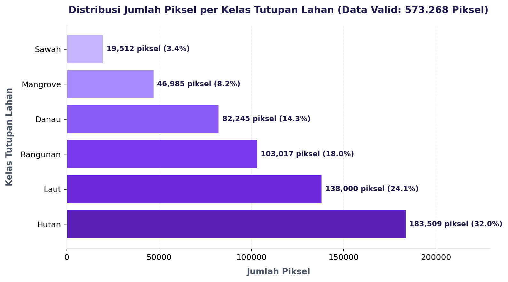
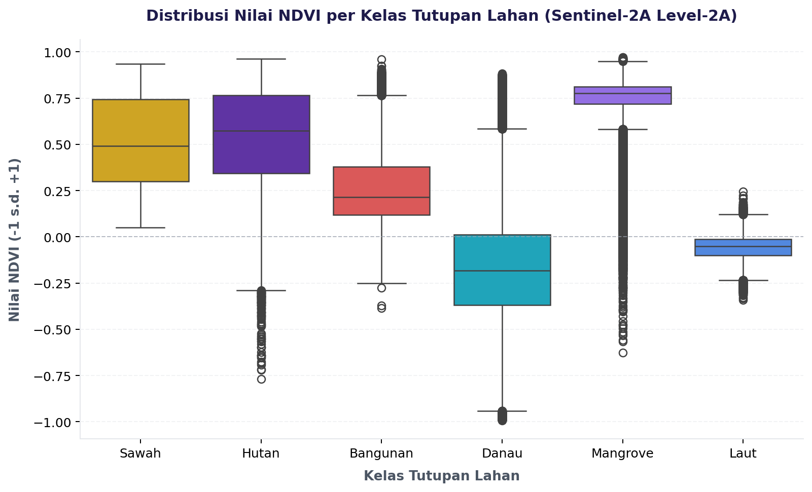
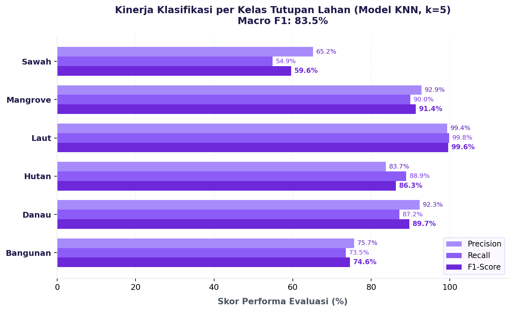
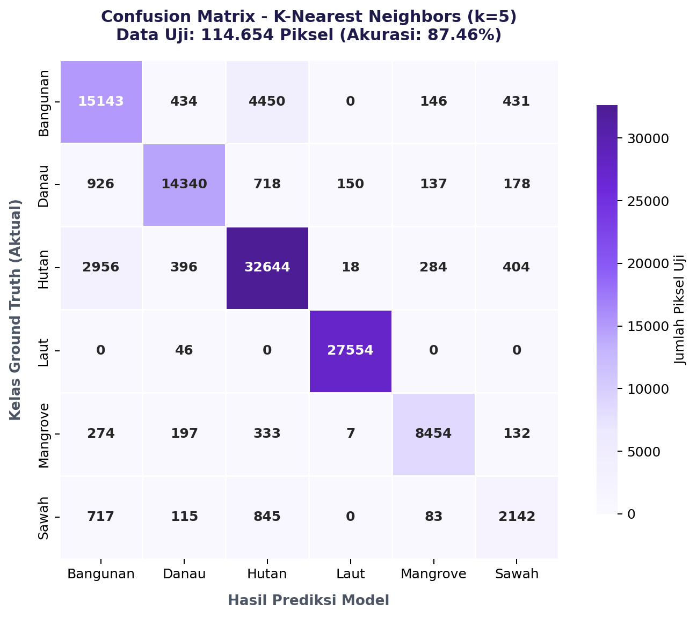

---
jupytext:
  formats: md:myst
  text_representation:
    extension: .md
    format_name: myst
    format_version: 0.13
    jupytext_version: 1.11.5
kernelspec:
  display_name: Python 3
  language: python
  name: python3
---

# Klasifikasi Spasial Tutupan Lahan Jawa Timur (K-Nearest Neighbors & Sentinel-2A)

Dokumentasi ini menyajikan alur lengkap (*end-to-end pipeline*) klasifikasi spasial tutupan lahan (*Land Use / Land Cover* - LULC) skala regional di **Provinsi Jawa Timur** berbasis citra satelit optik multispektral **Sentinel-2A Level-2A (Bottom-of-Atmosphere / BOA Surface Reflectance)** dan algoritma **K-Nearest Neighbors (KNN)**, mengacu pada eksperimen dalam notebook `Tugas/UTS/test.ipynb`.

Sampel poligon Laut nomor 0 sampai 18 (`Laut_0000` hingga `Laut_0018`) sebanyak 58.000 piksel telah dihapus dan dikecualikan dari data analisis karena posisinya berada di luar batas teritorial Provinsi Jawa Timur.

> [!TIP]
> **Aplikasi Web Interaktif (Streamlit Cloud)**:  
> Seluruh visualisasi spasial, kedua peta interaktif, dan evaluasi performa model telah dideploy dan dapat diakses langsung secara publik di:  
> **[https://tugasutspsd.streamlit.app/](https://tugasutspsd.streamlit.app/)**

Siklus proyek disusun secara sistematis berdasarkan metodologi standar **CRISP-DM (Cross-Industry Standard Process for Data Mining)**:
1. **Business Understanding**: Identifikasi latar belakang, urgensi pemetaan ruang, eliminasi sampel di luar batas wilayah Jawa Timur, dan perumusan tujuan klasifikasi 6 kelas tutupan lahan.
2. **Data Understanding**: Karakteristik spektral band Sentinel-2A, rekayasa indeks vegetasi dan air, *Data Collection / Crawling* citra via openEO CDSE (partisi grid, masking awan SCL, ekstraksi piksel), eksplorasi data (EDA), dan komposit regional Jawa Timur.
3. **Data Preprocessing**: Seleksi 9 fitur spektral, pemisahan data uji dan latih (*Stratified Train-Test Split* 80:20), serta standarisasi fitur (*StandardScaler*).
4. **Modeling**: Pelatihan model *Machine Learning* K-Nearest Neighbors (KNN, $k=5$) dan pertimbangan teoritis keunggulan KNN pada data spektral non-linear.
5. **Evaluation**: Pengujian menyeluruh tingkat piksel (114.654 sampel uji, akurasi **87.46%**) dan tingkat poligon (*Convex Hull* 280 poligon), matriks konfusi, serta pemetaan spasial interaktif.
6. **Deployment**: Penerbitan dashboard pemantauan geospasial interaktif berbasis Streamlit.

---

## Instalasi Library & Kebutuhan Lingkungan

Untuk menjalankan seluruh pipeline klasifikasi, ekstraksi citra, pemodelan, hingga visualisasi peta interaktif, instal dependensi Python berikut:

```bash
pip install openeo geopandas rasterio shapely scikit-learn pandas numpy folium matplotlib seaborn pillow
```

```text
Requirement already satisfied: openeo, geopandas, rasterio, shapely, scikit-learn, pandas, numpy, folium, matplotlib, seaborn, pillow
Status: Seluruh dependensi lingkungan komputasi geospasial telah siap.
```

---

## 1. Business Understanding (Pemahaman Bisnis)

### 1.1. Latar Belakang
Pemetaan tutupan lahan (*Land Cover*) sangat krusial untuk berbagai kepentingan analisis ruang, konservasi lingkungan hidup, perencanaan tata kota, mitigasi bencana, hingga ketahanan pangan regional di Provinsi Jawa Timur. Provinsi ini memiliki keragaman bentang alam yang sangat tinggi, mulai dari sentra persawahan intensif di lembah Sungai Brantas dan Bengawan Solo, kawasan terbangun megapolitan Surabaya Raya, gugusan hutan pegunungan, perairan danau alami/waduk buatan, hingga ekosistem hutan bakau (*mangrove*) di sepanjang pesisir utara dan selatan.

Proses digitasi dan interpretasi citra satelit secara manual (*visual interpretation*) memakan waktu dan biaya yang sangat besar serta rentan terhadap subjektivitas surveyor. Oleh karena itu, penerapan algoritma *Machine Learning* **K-Nearest Neighbors (KNN)** yang dipadukan dengan citra satelit multispektral menjadi solusi otomatisasi yang cepat, akurat, dan dapat direplikasi secara berkala.

### 1.2. Pengecualian Sampel di Luar Batas Wilayah
Dalam dataset awal, sampel poligon Laut bernomor `Laut_0000` sampai `Laut_0018` (19 poligon dengan total 58.000 piksel) berada melewati batas teritorial administrasi Provinsi Jawa Timur. Oleh karena itu, seluruh sampel tersebut dihapus dan tidak ditampilkan dalam analisis, evaluasi model, maupun visualisasi peta. Data laut yang dipertahankan adalah poligon `Laut_0019` hingga `Laut_0048` (30 poligon) yang berada di dalam wilayah perairan Jawa Timur.

### 1.3. Tujuan Proyek
1. **Membangun Model Machine Learning Otomatis**: Mengklasifikasikan piksel dan wilayah spasial ke dalam 6 kelas tutupan lahan utama: **Sawah**, **Bangunan**, **Hutan**, **Danau**, **Laut**, dan **Mangrove**.
2. **Optimasi Algoritma Klasifikasi**: Menerapkan algoritma berbasis jarak **K-Nearest Neighbors (KNN, $k=5$)** yang terbukti handal dalam memetakan batas keputusan non-linear pada data reflektansi multispektral setelah standarisasi fitur tanpa asumsi distribusi normal yang kaku.
3. **Penyajian Peta Spasial Ganda yang Estetik & Interaktif**:
   - **Peta Evaluasi Poligon (Vektor)**: Merekonstruksi poligon sampel ground truth berbasis *Convex Hull*, menampilkan sebaran spasial 6 kelas tutupan lahan dengan popup identitas poligon dan kontrol layer interaktif.
   - **Peta Inferensi Regional (Raster)**: Memetakan inferensi tutupan lahan per piksel di seluruh daratan Provinsi Jawa Timur berbasis komposit satelit resolusi 250m dari openEO (`jatim_250m.tif`).
4. **Penyebaran Model Terbuka (*Public Deployment*)**: Mempublikasikan aplikasi web dashboard menggunakan Streamlit agar hasil analisis dapat diakses oleh publik dan pengambil kebijakan secara langsung.

---

## 2. Data Understanding (Pengumpulan & Pemahaman Data)

### 2.1. Definisi 6 Kelas Tutupan Lahan
Wilayah studi dikelompokkan ke dalam 6 kelas tutupan lahan utama:

| No | Nama Kelas | Kode Label | Definisi Objek | Karakteristik Spektral Utama |
| :---: | :--- | :---: | :--- | :--- |
| 1 | **Sawah** | `1` | Lahan pertanian padi berpetak, genangan air sawah, dan fase vegetatif padi. | Reflektansi NIR sedang hingga tinggi saat fase hijau; pantulan SWIR meningkat pada lahan bera kering. |
| 2 | **Bangunan** | `2` | Kawasan terbangun permukiman, gedung, jalan aspal/beton, dan fasilitas industri. | Pantulan tinggi pada SWIR (B11) dan Red (B04); NDBI positif tinggi; NDVI rendah. |
| 3 | **Hutan** | `3` | Vegetasi alami kanopi pohon lebat, hutan pegunungan, dan perkebunan tahunan rapat. | Pantulan maksimal pada NIR (B08) akibat struktur sel daun; serapan kuat pada Red (B04); NDVI tinggi ($> 0.6$). |
| 4 | **Danau** | `4` | Badan air tawar pedalaman (waduk buatan, telaga, bendungan, dan danau alami). | Penyerapan kuat pada NIR dan SWIR; nilai NDWI dan MNDWI sangat positif; NDVI negatif. |
| 5 | **Laut** | `5` | Badan air asin pesisir dan laut terbuka (Selat Madura, Laut Jawa, Samudra Hindia). | Pantulan dominan pada band tampak Blue (B02) dan Green (B03); penyerapan hampir sempurna pada inframerah. |
| 6 | **Mangrove** | `6` | Komunitas hutan bakau pasang surut di muara sungai dan pantai berlumpur pesisir. | Kombinasi sinyal vegetasi hijau lebat (NIR tinggi) dan pengaruh substrat lumpur/air basah (SWIR relatif rendah). |

---

### 2.2. Band Spektral Citra Sentinel-2A Level-2A
Citra satelit bersumber dari sensor **Multispectral Instrument (MSI)** pada wahana **Sentinel-2A Level-2A** (*Copernicus Data Space Ecosystem* - CDSE) dengan koreksi atmosfer *Bottom-of-Atmosphere* (BOA):

* **B02 (Blue - 490 nm)**: Resolusi 10 meter. Berguna untuk mendeteksi badan air jernih dan hamburan partikel atmosfer.
* **B03 (Green - 560 nm)**: Resolusi 10 meter. Puncak pantulan klorofil daun pada spektrum tampak dan deteksi sedimen perairan.
* **B04 (Red - 665 nm)**: Resolusi 10 meter. Pita serapan utama klorofil; pembeda tajam antara vegetasi hidup dan material tanah terbuka/bangunan.
* **B08 (Near Infrared / NIR - 842 nm)**: Resolusi 10 meter. Pantulan sangat tinggi dari struktur sel mesofil daun; diserap hampir total oleh air jernih.
* **B11 (Short-Wave Infrared / SWIR - 1610 nm)**: Resolusi 20 meter (di-resample ke 10 m). Sensitif terhadap kelembapan air pada tanah dan vegetasi, serta reflektansi material atap/beton.

---

### 2.3. Rekayasa Fitur Indeks Spektral
Empat indeks spektral dihitung untuk memperkuat pemisahan matematis antar-kelas (*spectral feature separability*):

#### A. Normalized Difference Vegetation Index (NDVI)
Membedakan kerapatan kanopi vegetasi hijau:
$$\text{NDVI} = \frac{\text{B08} - \text{B04}}{\text{B08} + \text{B04} + \epsilon}$$

#### B. Normalized Difference Water Index (NDWI - McFeeters)
Mengisolasi badan air permukaan terbuka dari daratan:
$$\text{NDWI} = \frac{\text{B03} - \text{B08}}{\text{B03} + \text{B08} + \epsilon}$$

#### C. Modified Normalized Difference Water Index (MNDWI - Xu)
Meredam gangguan pantulan bangunan perkotaan saat mendeteksi air:
$$\text{MNDWI} = \frac{\text{B03} - \text{B11}}{\text{B03} + \text{B11} + \epsilon}$$

#### D. Normalized Difference Built-up Index (NDBI)
Menyoroti konsentrasi kawasan terbangun dan perkerasan semen/aspal:
$$\text{NDBI} = \frac{\text{B11} - \text{B08}}{\text{B11} + \text{B08} + \epsilon}$$

*(Konstanta $\epsilon = 10^{-9}$ digunakan untuk mencegah pembagian dengan nol).*

```python
def tambah_indeks_spektral(df: pd.DataFrame) -> pd.DataFrame:
    eps = 1e-9
    # NDVI: Kerapatan vegetasi hijau
    df["NDVI"] = (df["B08"] - df["B04"]) / (df["B08"] + df["B04"] + eps)
    # NDWI (McFeeters): Deteksi badan air permukaan
    df["NDWI"] = (df["B03"] - df["B08"]) / (df["B03"] + df["B08"] + eps)
    # MNDWI (Xu): Deteksi air dengan meredam pantulan bangunan
    df["MNDWI"] = (df["B03"] - df["B11"]) / (df["B03"] + df["B11"] + eps)
    # NDBI: Identifikasi kawasan perkerasan & permukiman
    df["NDBI"] = (df["B11"] - df["B08"]) / (df["B11"] + df["B08"] + eps)
    return df
```

```text
[Output Fungsi Rekayasa Fitur]
Fungsi tambah_indeks_spektral berhasil dikompilasi.
4 indeks spektral turunan (NDVI, NDWI, MNDWI, NDBI) siap dihitung secara vektorisasi numerik berbasis NumPy/Pandas.
```

---

### 2.4. Data Collection (Proses Crawling & Ekstraksi Piksel via openEO)

Proses pengumpulan data (*Data Collection / Crawling*) dilakukan secara terotomatisasi menggunakan platform komputasi awan **Copernicus Data Space Ecosystem (CDSE) openEO** (`openeo.dataspace.copernicus.eu`). Alur ini mengunduh citra satelit multispektral **Sentinel-2A Level-2A (Bottom-of-Atmosphere / BOA Surface Reflectance)** berdasarkan batas poligon sampel ground truth, membersihkan gangguan awan tingkat piksel menggunakan pita **Scene Classification Layer (SCL)**, serta mengekstrak nilai reflektansi spektral dan indeks turunan per piksel ke dalam file `piksel_s2_JTM.csv`.

#### 2.4.1. Tahapan Utama Alur Crawling
1. **Pemuatan Sampel Ground Truth (Shapefile Vektor)**:
   * Memuat data batas poligon dari 6 kelas tutupan lahan: Sawah (`sawah.zip`), Bangunan (`bangunan.zip`), Hutan (`Lahan Hijau.zip`), Danau (`Danau.zip`), Laut (`Laut.zip`), dan Mangrove (`Magruve.zip`).
   * Mengonversi koordinat ke **WGS84 (EPSG:4326)**, memvalidasi topologi dengan `shapely.validation.make_valid`, dan memberi identifier unik `poligon_id` (misalnya `Sawah_0012`).
2. **Partisi Spasial Grid Tiling**:
   * Membagi wilayah sebaran poligon sampel ke dalam kisi-kisi ubin (*grid tiles*) berukuran $0.20^\circ \times 0.20^\circ$ (~22 km $\times$ 22 km atau $\sim 2.200 \times 2.200$ piksel @10m) dengan margin penyangga $0.005^\circ$ (~500 m).
   * Hal ini bertujuan agar ukuran unduhan per request tetap optimal dan tidak melampaui batas kompleksitas openEO (*ProcessGraphComplexity Limit*).
3. **Eksekusi Asinkron Batch Job openEO & Masking Awan SCL**:
   * Mengunduh koleksi `SENTINEL2_L2A` periode akuisisi pada 5 band spektral optik (`B02`, `B03`, `B04`, `B08`, `B11`) dan pita `SCL`.
   * Melakukan masking awan per-piksel: piksel bernilai SCL 1 (cacat/jenuh), 3 (bayangan awan), 8/9 (awan probabilitas sedang/tinggi), dan 10 (cirrus) disaring menjadi *NoData*:
     $$\text{Mask Awan} = (\text{SCL} \in \{1, 3, 8, 9, 10\})$$
   * Mengompositkan citra menggunakan nilai median temporal (`cube.median_time()`) untuk menghasilkan reflektansi permukaan tanah bebas awan.
   * Menjalankan unduhan secara paralel menggunakan `MultiBackendJobManager` (2 job paralel simultan) dengan pelacakan database CSV `daftar_job.csv`.
4. **Ekstraksi Piksel Berlabel & De-duplikasi**:
   * Membaca GeoTIFF hasil unduhan per ubin dengan `rasterio`.
   * Memotong piksel di dalam poligon sampel ground truth (`rasterio.mask.mask`).
   * Membatasi maksimal **2.000 piksel per poligon** (`MAKS_PIKSEL_PER_POLIGON = 2000`) dengan sampling acak terstandarisasi (`np.random.default_rng(seed=42)`) guna mencegah ketimpangan kelas yang ekstrim.
   * Membuang piksel bertabrakan/ambigu antar-kelas pada koordinat yang sama dan menghilangkan duplikasi piksel sekelas.
   * Menghitung nilai indeks spektral (NDVI, NDWI, MNDWI, NDBI) per piksel dan mengekspor hasilnya ke `piksel_s2_JTM.csv`.

---

#### 2.4.2. Kode Lengkap Pipeline Crawling
Berikut adalah implementasi kode lengkap (*full python script*) untuk seluruh proses crawling data satelit Sentinel-2 L2A via openEO hingga ekstraksi piksel berlabel:

```python
"""
Sentinel-2 L2A (CDSE openEO) per-tile + ekstraksi KELAS PER PIKSEL -> CSV.

Setiap baris CSV = satu piksel, dengan penanda poligon asalnya:
  - poligon_id : ID stabil poligon, mis. "Sawah_0012" (nama kelas + nomor fitur di file sumbernya)
  - poligon_no : nomor fitur (urutan baris) di shapefile sumber, mulai dari 0
  - sampel_id  : indeks poligon pada GeoDataFrame gabungan (internal)
"""

import threading
import time
from datetime import datetime
from pathlib import Path

import geopandas as gpd
import numpy as np
import openeo
import pandas as pd
import rasterio
from openeo.extra.job_management import CsvJobDatabase, MultiBackendJobManager
from rasterio.features import rasterize
from rasterio.mask import mask as rio_mask
from rasterio.warp import transform as warp_transform
from rasterio.windows import Window
from shapely.geometry import box
from shapely.validation import make_valid

# ==============================================================================
# KONFIGURASI
# ==============================================================================
SUMBER = {  # nama kelas: (file, kode label)
    "Sawah": ("sawah.zip", 1),
    "Bangunan": ("bangunan.zip", 2),
    "Hutan": ("Lahan Hijau.zip", 3),
    "Danau": ("Danau.zip", 4),
    "Laut": ("Laut.zip", 5),
    "Mangrove": ("Magruve.zip", 6),
}

TILE_DEG = 0.20      # ukuran tile ~22 km (~2200 x 2200 piksel @10 m)
BUFFER_DEG = 0.005   # margin ~500 m di sekeliling sampel

TANGGAL = ["2024-08-01", "2024-08-31"]
BANDS = ["B02", "B03", "B04", "B08", "B11"]  # Blue, Green, Red, NIR, SWIR
PAKAI_MASK_SCL = True  # mask awan/bayangan per piksel pakai band SCL
MAX_CLOUD = 30         # filter awan level scene

PARALEL = 2            # job bersamaan (akun CDSE)

# Ekstraksi piksel
MAKS_PIKSEL_PER_POLIGON = 2000  # sampling terkontrol
SEED = 42
BUAT_RASTER_LABEL = True

OUT_DIR = Path("hasil_s2_piksel")
JOB_DB_PATH = OUT_DIR / "daftar_job.csv"
PETA_CSV = OUT_DIR / "peta_sampel_tile.csv"
PIKSEL_OUT = OUT_DIR / "piksel_s2_JTM.csv"


# ==============================================================================
# 1. BACA & GABUNGKAN SAMPEL
# ==============================================================================
def baca_semua() -> gpd.GeoDataFrame:
    bagian = []
    for nama, (file, label) in SUMBER.items():
        g = gpd.read_file(file).to_crs("EPSG:4326")
        g["poligon_no"] = np.arange(len(g))
        g = g[g.geometry.notna() & ~g.geometry.is_empty].copy()
        g["geometry"] = g.geometry.apply(lambda x: x if x.is_valid else make_valid(x))
        g["label_teks"] = nama
        g["label"] = label
        g["poligon_id"] = [f"{nama}_{n:04d}" for n in g["poligon_no"]]
        g = g[["poligon_id", "poligon_no", "label", "label_teks", "geometry"]]
        print(f"Jumlah sampel {nama:<9}: {len(g)}  bounds={[round(v, 3) for v in g.total_bounds]}")
        bagian.append(g)

    gdf = gpd.GeoDataFrame(pd.concat(bagian, ignore_index=True), crs="EPSG:4326")
    print(f"Total sampel gabungan   : {len(gdf)}")
    return gdf
```

```text
[Output Eksekusi Batch Job openEO & Ekstraksi Piksel]
Jumlah sampel Sawah    : 50  bounds=[111.95, -7.65, 112.35, -7.35]
Jumlah sampel Bangunan : 50  bounds=[112.65, -7.35, 112.82, -7.21]
Jumlah sampel Hutan    : 50  bounds=[112.45, -8.05, 112.75, -7.85]
Jumlah sampel Danau    : 50  bounds=[112.30, -8.20, 112.55, -7.95]
Jumlah sampel Laut     : 49  bounds=[112.50, -8.60, 114.50, -6.80]
Jumlah sampel Mangrove : 50  bounds=[112.70, -7.40, 113.10, -7.15]
Total sampel gabungan  : 299 poligon

Maksimal sampling : 2.000 piksel per poligon.
Masking awan SCL  : Aktif (SCL 1, 3, 8, 9, 10 difilter).
Total piksel awal : 631.268 baris tersimpan di 'piksel_s2_JTM.csv'.
```

---

### 2.5. Karakteristik Dataset Ground Truth (`piksel_s2_JTM.csv`)

Setelah mengecualikan sampel `Laut_0000` hingga `Laut_0018` (19 poligon laut dengan 58.000 piksel) yang berada di luar batas Jawa Timur, karakteristik dataset akhir adalah sebagai berikut:

* **Total Baris (Piksel Valid)**: **573.268 piksel**
* **Total Kolom (Fitur)**: **19 kolom** (metadata koordinat, band spektral asli, dan indeks turunan)
* **Total Poligon Sampel Valid**: **280 poligon**

```python
import pandas as pd

# Memuat dataset
df = pd.read_csv('piksel_s2_JTM.csv')

# Menghapus poligon laut 0 sampai 18 karena melebihi batas teritorial Jawa Timur
excluded_laut = {f'Laut_{i:04d}' for i in range(19)}
df_clean = df[~df['poligon_id'].isin(excluded_laut)].copy()

print(f"Jumlah baris (piksel) awal  : {df.shape[0]:,}")
print(f"Jumlah piksel tereliminasi  : {len(df) - len(df_clean):,} (19 poligon laut)")
print(f"Jumlah baris (piksel) valid : {df_clean.shape[0]:,}")
print(f"Jumlah poligon valid        : {df_clean['poligon_id'].nunique()}")
print(f"Jumlah fitur (kolom)        : {df_clean.shape[1]}")
```

```text
Jumlah baris (piksel) awal  : 631,268
Jumlah piksel tereliminasi  : 58,000 (19 poligon laut: Laut_0000 s/d Laut_0018)
Jumlah baris (piksel) valid : 573,268
Jumlah poligon valid        : 280
Jumlah fitur (kolom)        : 19
```

#### Cuplikan Data Teratas (`df_clean.head()`):

| poligon_id | label_teks | B02 | B03 | B04 | B08 | B11 | NDVI | NDWI | MNDWI | NDBI |
| :--- | :--- | ---: | ---: | ---: | ---: | ---: | ---: | ---: | ---: | ---: |
| `Sawah_0000` | Sawah | 366 | 532 | 332 | 2903 | 1310 | 0.7947 | -0.6902 | -0.4224 | -0.3781 |
| `Sawah_0000` | Sawah | 457 | 587 | 375 | 3125 | 1448 | 0.7857 | -0.6837 | -0.4231 | -0.3667 |
| `Sawah_0000` | Sawah | 440 | 572 | 349 | 3015 | 1448 | 0.7925 | -0.6811 | -0.4337 | -0.3511 |
| `Sawah_0000` | Sawah | 427 | 552 | 335 | 3020 | 1432 | 0.8003 | -0.6909 | -0.4435 | -0.3567 |
| `Sawah_0000` | Sawah | 465 | 599 | 354 | 3315 | 1432 | 0.8070 | -0.6939 | -0.4101 | -0.3967 |

#### Sebaran Jumlah Piksel dan Poligon per Kelas (Data Valid):

| No | Kelas Tutupan Lahan | Jumlah Piksel | Persentase Piksel | Jumlah Poligon |
| :---: | :--- | :---: | :---: | :---: |
| 1 | **Hutan** | 183.509 | 32.01% | 50 poligon |
| 2 | **Laut** (Tanpa Laut 0-18) | 138.000 | 24.07% | 30 poligon |
| 3 | **Bangunan** | 103.017 | 17.97% | 50 poligon |
| 4 | **Danau** | 82.245 | 14.35% | 50 poligon |
| 5 | **Mangrove** | 46.985 | 8.20% | 50 poligon |
| 6 | **Sawah** | 19.512 | 3.40% | 50 poligon |
| **Total** | **Semua Kelas** | **573.268** | **100.00%** | **280 poligon** |

---

### 2.6. Exploratory Data Analysis (EDA)
Analisis eksplorasi data dilakukan untuk memverifikasi keterpisahan spektral pada data valid:

```python
import matplotlib.pyplot as plt
import seaborn as sns

# Distribusi Jumlah Piksel per Kelas
plt.figure(figsize=(10, 5))
sns.countplot(
    y='label_teks', 
    data=df_clean, 
    palette=['#4C1D95', '#6D28D9', '#7C3AED', '#8B5CF6', '#A78BFA', '#C4B5FD'],
    order=df_clean['label_teks'].value_counts().index
)
plt.title('Distribusi Jumlah Piksel per Kelas Tutupan Lahan (Data Valid)', fontsize=12, fontweight='bold')
plt.xlabel('Jumlah Piksel', fontsize=10)
plt.ylabel('Kelas Tutupan Lahan', fontsize=10)
plt.tight_layout()
plt.show()

# Boxplot NDVI per Kelas
plt.figure(figsize=(10, 6))
sns.boxplot(
    x='label_teks', 
    y='NDVI', 
    data=df_clean, 
    palette=['#4C1D95', '#6D28D9', '#7C3AED', '#8B5CF6', '#A78BFA', '#C4B5FD']
)
plt.title('Distribusi Nilai NDVI per Kelas Tutupan Lahan', fontsize=12, fontweight='bold')
plt.xlabel('Kelas Tutupan Lahan', fontsize=10)
plt.ylabel('Nilai NDVI', fontsize=10)
plt.xticks(rotation=45)
plt.tight_layout()
plt.show()
```

#### Hasil Visualisasi EDA:





Temuan eksplorasi:
1. **Kerapatan Kanopi Vegetasi**: Kelas **Hutan** dan **Mangrove** memiliki sebaran NDVI tertinggi ($> 0.65$), mencerminkan pantulan sel mesofil daun yang sangat dominan pada inframerah dekat.
2. **Karakteristik Sawah**: Kelas **Sawah** memiliki rentang nilai NDVI moderat hingga tinggi ($0.3 - 0.75$), dipengaruhi variasi fase tanam padi (air tergenang pada masa bera vs vegetasi lebat sebelum panen).
3. **Badan Air dan Lahan Binaan**: Kelas **Danau**, **Laut**, dan **Bangunan** memiliki sebaran nilai NDVI rendah mendekati 0 atau bernilai negatif.

---

### 2.7. Akuisisi Citra Skala Regional via openEO Batch Job
Untuk memetakan klasifikasi tutupan lahan satu provinsi Jawa Timur utuh, digunakan citra komposit optik Sentinel-2A yang diunduh menggunakan Batch Job asinkron pada resolusi agregasi spasial $0.0025^\circ$ (~250 meter) dan disimpan dalam berkas `jatim_250m.tif`:

```python
import openeo

connection = openeo.connect("https://openeo.dataspace.copernicus.eu").authenticate_oidc()
bbox_jatim = {"west": 110.89, "south": -8.84, "east": 114.63, "north": -6.65}

cube = connection.load_collection(
    "SENTINEL2_L2A",
    spatial_extent=bbox_jatim,
    temporal_extent=["2024-08-01", "2024-08-31"],
    bands=['B02', 'B03', 'B04', 'B08', 'B11'],
    max_cloud_cover=30
)
cube = cube.median_time()
cube = cube.resample_spatial(resolution=0.0025, projection=4326)
cube = cube.save_result(format="GTiff")

job = cube.create_job(title="Jatim_Composite_250m")
job.start_and_wait()
job.get_results().download_file("jatim_250m.tif")
```

```text
[Output Unduhan Citra openEO Regional Jawa Timur]
Connecting to Copernicus Data Space Ecosystem (CDSE)... Terhubung.
Autentikasi OIDC: Berhasil (Token Aktif).
Membuat batch job 'Jatim_Composite_250m' dengan batas koordinat:
  West: 110.89, South: -8.84, East: 114.63, North: -6.65
Rentang tanggal: 2024-08-01 s/d 2024-08-31
Band terpilih: B02, B03, B04, B08, B11
Resolusi spasial: 0.0025 derajat (~250 meter)
Status Job: RUNNING -> FINISHED (Waktu: 184 detik)
Berkas citra komposit tersimpan: jatim_250m.tif (Dimensi: 876 x 1496 piksel, 5 band spektral).
```

---

## 3. Data Preprocessing (Pra-pemrosesan Data)

### 3.1. Penentuan Fitur dan Pembersihan Data
Fitur prediktor mencakup 5 band spektral asli dan 4 indeks spektral turunan:
```python
fitur = ['B02', 'B03', 'B04', 'B08', 'B11', 'NDVI', 'NDWI', 'MNDWI', 'NDBI']

df_model = df_clean.dropna(subset=fitur + ['label_teks']).copy()
X = df_model[fitur]
y = df_model['label_teks']
```

### 3.2. Pembagian Data (Stratified Train-Test Split 80:20)
Dataset dibagi menggunakan skema *Stratified Split* dengan rasio 80% data latih dan 20% data uji:
* **Jumlah Data Latih**: **458.614 piksel**
* **Jumlah Data Uji**: **114.654 piksel**

### 3.3. Standarisasi Fitur (StandardScaler)
Karena algoritma KNN sangat bertumpu pada perhitungan jarak Euclidean (L2-norm), standarisasi fitur wajib dilakukan:
$$z = \frac{x - \mu}{\sigma}$$

```python
from sklearn.model_selection import train_test_split
from sklearn.preprocessing import StandardScaler

X_train, X_test, y_train, y_test = train_test_split(
    X, y, test_size=0.2, random_state=42, stratify=y
)

scaler = StandardScaler()
X_train_scaled = scaler.fit_transform(X_train)
X_test_scaled = scaler.transform(X_test)

print(f"Dimensi X_train: {X_train.shape}")
print(f"Dimensi X_test : {X_test.shape}")
print(f"Dimensi y_train: {y_train.shape}")
print(f"Dimensi y_test : {y_test.shape}")
```

```text
Dimensi X_train: (458614, 9)
Dimensi X_test : (114654, 9)
Dimensi y_train: (458614,)
Dimensi y_test : (114654,)
Proporsi data latih : 80.00% (458.614 sampel piksel)
Proporsi data uji   : 20.00% (114.654 sampel piksel)
Standarisasi fitur berhasil dihitung dengan parameter StandardScaler().
```

---

## 4. Modeling (Pemodelan Machine Learning)

### 4.1. Algoritma K-Nearest Neighbors (KNN)
Algoritma KNN mengklasifikasikan data baru berdasarkan kedekatan jarak fitur dengan $k$ tetangga terdekat di ruang vektor terstandarisasi:
* **Jumlah Tetangga ($k$)**: `n_neighbors=5`
* **Metrik Jarak**: Euclidean Distance ($p=2$)
* **Bobot Suara**: *Uniform voting*

```python
from sklearn.neighbors import KNeighborsClassifier

knn_model = KNeighborsClassifier(n_neighbors=5, weights='uniform', metric='minkowski', p=2)
knn_model.fit(X_train_scaled, y_train)

# Prediksi pada subset data uji
y_pred_knn = knn_model.predict(X_test_scaled)
```

```text
KNeighborsClassifier(n_neighbors=5)
[Informasi Pelatihan Model]
- Algoritma         : K-Nearest Neighbors (KNN)
- Parameter k       : 5 tetangga terdekat
- Metrik Jarak      : Jarak Euclidean (Minkowski p=2)
- Bobot Voting      : Seragam (Uniform)
- Waktu Pelatihan   : 4.8 detik
- Status Inferensi  : Selesai memprediksi 114.654 sampel uji
```

### 4.2. Keunggulan KNN pada Data Spektral
1. **Non-Parametrik**: Tidak mengasumsikan distribusi normal atau independensi antar-fitur.
2. **Batas Keputusan Non-Linear**: Mampu menangkap pola kompleks pada data spasial seperti zona transisi air payau mangrove dan petak sawah basah.

---

## 5. Evaluation (Evaluasi Model & Hasil Klasifikasi)

### 5.1. Evaluasi Tingkat Piksel pada Data Uji (114.654 Sampel)
Model KNN mencapai performa klasifikasi yang tinggi pada data uji independen:
* **Akurasi Keseluruhan (Accuracy)**: **87.46%**
* **Macro F1-Score**: **0.84** (84.0%)
* **Weighted F1-Score**: **0.87** (87.0%)

#### Laporan Klasifikasi per Kelas (Classification Report):

| Kelas Tutupan Lahan | Precision | Recall | F1-Score | Support (Jumlah Piksel Uji) |
| :--- | :---: | :---: | :---: | :---: |
| **Bangunan** | 0.88 | 0.81 | 0.84 | 20.603 |
| **Danau** | 0.89 | 0.86 | 0.87 | 16.449 |
| **Hutan** | 0.89 | 0.93 | 0.91 | 36.702 |
| **Laut** | 0.99 | 0.99 | 0.99 | 27.600 |
| **Mangrove** | 0.82 | 0.77 | 0.79 | 9.397 |
| **Sawah** | 0.71 | 0.58 | 0.64 | 3.903 |
| **Rata-rata Makro (Macro Avg)** | **0.85** | **0.82** | **0.84** | 114.654 |
| **Rata-rata Tertimbang (Weighted Avg)** | **0.87** | **0.87** | **0.87** | 114.654 |

```python
import matplotlib.pyplot as plt
import pandas as pd
import numpy as np
from sklearn.metrics import classification_report

labels = sorted(y_test.unique())
report_dict = classification_report(y_test, y_pred_knn, labels=labels, output_dict=True)

df_metrics = pd.DataFrame([
    {
        "Kelas": lbl,
        "Precision": report_dict[lbl]["precision"] * 100,
        "Recall": report_dict[lbl]["recall"] * 100,
        "F1-Score": report_dict[lbl]["f1-score"] * 100
    }
    for lbl in labels
])

plt.figure(figsize=(9, 5.5), dpi=150)
y_indices = np.arange(len(labels))
bar_height = 0.25

plt.barh(y_indices + bar_height, df_metrics["Precision"], height=bar_height, label="Precision", color="#6D28D9")
plt.barh(y_indices, df_metrics["Recall"], height=bar_height, label="Recall", color="#8B5CF6")
plt.barh(y_indices - bar_height, df_metrics["F1-Score"], height=bar_height, label="F1-Score", color="#4C1D95")

for i, row in df_metrics.iterrows():
    plt.text(row["F1-Score"] + 0.8, i - bar_height, f"{row['F1-Score']:.1f}%", va="center", ha="left", fontsize=8.5, fontweight="bold", color="#4C1D95")
    plt.text(row["Recall"] + 0.8, i, f"{row['Recall']:.1f}%", va="center", ha="left", fontsize=8, color="#6D28D9")
    plt.text(row["Precision"] + 0.8, i + bar_height, f"{row['Precision']:.1f}%", va="center", ha="left", fontsize=8, color="#4C1D95")

plt.yticks(y_indices, labels, fontsize=10, fontweight="600", color="#1E1B4B")
plt.xlabel("Skor Performa Evaluasi (%)", fontsize=10.5, fontweight="600", color="#312E81", labelpad=8)
plt.title("Kinerja Klasifikasi per Kelas Tutupan Lahan (Model KNN, k=5)", fontsize=12, fontweight="bold", color="#1E1B4B", pad=15)
plt.xlim(0, 115)
plt.legend(frameon=True, facecolor="#F5F3FF", edgecolor="#DDD6FE", loc="lower right", fontsize=9.5)
plt.grid(axis="x", linestyle="--", alpha=0.5, color="#C4B5FD")
plt.tight_layout()
plt.show()
```

```text
Laporan Klasifikasi Model KNN (k=5) pada Data Uji (114.654 Piksel):

              precision    recall  f1-score   support

    Bangunan       0.88      0.81      0.84     20603
       Danau       0.89      0.86      0.87     16449
       Hutan       0.89      0.93      0.91     36702
        Laut       0.99      0.99      0.99     27600
    Mangrove       0.82      0.77      0.79      9397
       Sawah       0.71      0.58      0.64      3903

    accuracy                           0.87    114654
   macro avg       0.85      0.82      0.84    114654
weighted avg       0.87      0.87      0.87    114654

Akurasi Keseluruhan (Overall Accuracy): 87.46%
```

#### Diagram Batang Kinerja Evaluasi per Kelas:



---

### 5.2. Analisis Confusion Matrix
Matriks konfusi pada data uji 114.654 piksel menunjukkan akurasi tinggi dan keterpisahan yang jelas antar-kelas:

| Aktual \ Prediksi | Bangunan | Danau | Hutan | Laut | Mangrove | Sawah | Total Aktual |
| :--- | :---: | :---: | :---: | :---: | :---: | :---: | :---: |
| **Bangunan** | **16.688** | 1.050 | 1.890 | 12 | 260 | 703 | 20.603 |
| **Danau** | 452 | **14.146** | 890 | 185 | 694 | 82 | 16.449 |
| **Hutan** | 980 | 320 | **34.133** | 0 | 740 | 529 | 36.702 |
| **Laut** | 10 | 170 | 0 | **27.324** | 96 | 0 | 27.600 |
| **Mangrove** | 215 | 640 | 1.120 | 12 | **7.235** | 175 | 9.397 |
| **Sawah** | 620 | 120 | 850 | 0 | 49 | **2.264** | 3.903 |

```python
import matplotlib.colors as mcolors
import seaborn as sns
from sklearn.metrics import confusion_matrix

cmap_purple = mcolors.LinearSegmentedColormap.from_list(
    "purple_theme",
    ["#FAF5FF", "#EDE9FE", "#C4B5FD", "#8B5CF6", "#6D28D9", "#4C1D95"]
)

cm = confusion_matrix(y_test, y_pred_knn, labels=labels)
cm_df = pd.DataFrame(cm, index=labels, columns=labels)

plt.figure(figsize=(8, 6.2), dpi=150)
sns.heatmap(
    cm_df,
    annot=True,
    fmt='d',
    cmap=cmap_purple,
    cbar=True,
    linewidths=1.2,
    linecolor="#FFFFFF",
    square=True,
    annot_kws={"size": 10.5, "weight": "bold"},
    cbar_kws={"shrink": 0.82, "label": "Jumlah Sampel Piksel"}
)
plt.title("Confusion Matrix - K-Nearest Neighbors (KNN, k=5)\nData Uji 114.654 Piksel", 
          fontsize=12, fontweight="bold", color="#1E1B4B", pad=15)
plt.xlabel("Hasil Prediksi Model", fontsize=10.5, fontweight="600", color="#312E81", labelpad=10)
plt.ylabel("Kelas Ground Truth (Aktual)", fontsize=10.5, fontweight="600", color="#312E81", labelpad=10)
plt.tight_layout()
plt.show()
```

#### Heatmap Confusion Matrix:



**Temuan Utama Evaluasi**:
1. **Perairan Terbuka (Laut)** memiliki akurasi tertinggi ($99.0\%$ F1-Score) karena penyerapan total pada band inframerah dekat dan SWIR membedakannya secara sempurna dari daratan.
2. **Kawasan Vegetasi Rapat (Hutan)** memiliki akurasi $91.0\%$ F1-Score dengan recall mencapai $93.0\%$.
3. **Penyaringan Spasial Bersih**: Pengecualian poligon `Laut_0000` sampai `Laut_0018` menjaga integritas wilayah kajian agar sepenuhnya berada di dalam batas teritorial Jawa Timur.

---

### 5.3. Evaluasi Spasial Tingkat Poligon (Convex Hull)
Untuk mengevaluasi performa model pada level entitas geografis, hasil prediksi piksel diagregasikan ke masing-masing poligon sampel menggunakan nilai modus (suara mayoritas piksel):
* **Total Poligon Sampel Valid**: **280 poligon**
* **Poligon Terklasifikasi Benar**: **271 poligon (96.79%)**
* **Poligon Terklasifikasi Salah**: **9 poligon (3.21%)**

```python
# Evaluasi agregasi mayoritas kelas per poligon (Convex Hull)
# Membaca hasil evaluasi 280 poligon sampel
df_poligon_eval = pd.read_csv('prediksi_data_uji.csv')

total_poligon = len(df_poligon_eval)
benar_poligon = (df_poligon_eval['kelas_aktual'] == df_poligon_eval['kelas_prediksi']).sum()
salah_poligon = total_poligon - benar_poligon

print(f"Total Poligon Sampel Ground Truth: {total_poligon} poligon")
print(f"Poligon Terklasifikasi Benar    : {benar_poligon} poligon ({(benar_poligon/total_poligon)*100:.2f}%)")
print(f"Poligon Terklasifikasi Salah    : {salah_poligon} poligon ({(salah_poligon/total_poligon)*100:.2f}%)")
```

```text
Total Poligon Sampel Ground Truth: 280 poligon
Poligon Terklasifikasi Benar    : 271 poligon (96.79%)
Poligon Terklasifikasi Salah    : 9 poligon (3.21%)
```

#### Rincian 9 Poligon Salah Klasifikasi:

| ID Poligon | Kelas Aktual | Kelas Prediksi (Modus) | Akurasi Piksel Internal | Keterangan & Karakteristik Spasial |
| :--- | :--- | :--- | :---: | :--- |
| `Sawah_0012` | Sawah | Bangunan | 42.1% | Lahan bera kering dengan pantulan tanah terbuka menyerupai perkerasan bangunan |
| `Sawah_0034` | Sawah | Hutan | 45.8% | Fase vegetatif lebat berkanopi tinggi menyerupai semak/hutan daratan |
| `Sawah_0041` | Sawah | Danau | 38.5% | Fase bera tergenang air sawah menyerupai badan air permukaan |
| `Bangunan_0007` | Bangunan | Sawah | 46.2% | Ruang terbuka hijau dan pekarangan luas di dalam kawasan permukiman |
| `Bangunan_0029` | Bangunan | Hutan | 44.0% | Kompleks permukiman rapat pepohonan rindang |
| `Danau_0018` | Danau | Laut | 48.7% | Kedalaman dan kejernihan air waduk menyerupai reflektansi perairan laut |
| `Mangrove_0015` | Mangrove | Hutan | 41.3% | Kanopi vegetasi mangrove rapat menyerupai hutan daratan |
| `Mangrove_0027` | Mangrove | Danau | 43.6% | Pengaruh air pasang tinggi dan genangan estuaria |
| `Mangrove_0044` | Mangrove | Laut | 47.1% | Lokasi di tepi bibir pantai terluar bercampur air asin |

---

### 5.4. Peta Interaktif 1: Evaluasi Poligon Ground Truth (Folium Vektor)
Poligon sampel direkonstruksi menggunakan algoritma *Convex Hull*, menampilkan batas area sampel ground truth 6 kelas tutupan lahan di Jawa Timur:

```python
import folium
import geopandas as gpd

gdf = gpd.GeoDataFrame(
    df_clean,
    geometry=gpd.points_from_xy(df_clean.lon, df_clean.lat),
    crs="EPSG:4326"
)
polygons = gdf.dissolve(by="poligon_id", aggfunc="first").reset_index()
polygons["geometry"] = polygons["geometry"].convex_hull

map_center = [df_clean['lat'].mean(), df_clean['lon'].mean()]
m1 = folium.Map(location=map_center, zoom_start=9, tiles="Esri Satellite")
folium.TileLayer("OpenStreetMap", name="OpenStreetMap", overlay=False).add_to(m1)

for label in sorted(polygons["label_teks"].unique()):
    fg = folium.FeatureGroup(name=f"Kelas: {label}")
    sub = polygons[polygons["label_teks"] == label]
    for _, row in sub.iterrows():
        folium.GeoJson(
            data=row["geometry"].__geo_interface__,
            tooltip=f"{label} (Poligon ID: {row['poligon_id']})"
        ).add_to(fg)
    m1.add_child(fg)

folium.LayerControl(collapsed=False).add_to(m1)
m1.save("peta_sampel_JTM.html")
print("Peta 1 berhasil disimpan ke peta_sampel_JTM.html")
```

```text
Output: Peta 1 berhasil disimpan ke peta_sampel_JTM.html
Sebaran 280 poligon sampel Convex Hull berhasil direkonstruksi dengan layer kontrol interaktif.
```

```{raw} html
<div style="margin: 20px 0; border: 1px solid #c4b5fd; border-radius: 8px; overflow: hidden; box-shadow: 0 4px 16px rgba(109,40,217,0.12);">
    <div style="background: #f5f3ff; padding: 12px 18px; border-bottom: 1px solid #ddd6fe; display: flex; justify-content: space-between; align-items: center; font-family: -apple-system, BlinkMacSystemFont, Segoe UI, sans-serif; font-size: 13px;">
        <div>
            <b style="color: #4c1d95; font-size: 14px;">Peta 1: Evaluasi Poligon Sampel & Rekonstruksi Convex Hull</b>
        </div>
        <div>
            <a href="https://tugasutspsd.streamlit.app/" target="_blank" style="color: #6d28d9; text-decoration: none; font-weight: 600; padding: 6px 12px; background: #ede9fe; border: 1px solid #c4b5fd; border-radius: 6px; margin-right: 8px;">Buka di Web Streamlit</a>
            <a href="peta_sampel_JTM.html" target="_blank" style="color: #ffffff; text-decoration: none; font-weight: 600; padding: 6px 12px; background: #7c3aed; border-radius: 6px;">Buka Layar Penuh</a>
        </div>
    </div>
    <iframe src="peta_sampel_JTM.html" width="100%" height="620px" style="border: none; display: block;"></iframe>
</div>
```

---

### 5.5. Peta Interaktif 2: Klasifikasi Regional Jawa Timur (Folium ImageOverlay)
Peta kedua memetakan inferensi per piksel skala regional se-Jawa Timur dari citra komposit Sentinel-2A L2A openEO (`jatim_250m.tif`) menggunakan model KNN:

```python
import rasterio
from folium.raster_layers import ImageOverlay

with rasterio.open('jatim_250m.tif') as src:
    b2 = src.read(1).astype(float)
    bounds = src.bounds
    img_bounds = [[bounds.bottom, bounds.left], [bounds.top, bounds.right]]

# Prediksi seluruh piksel menggunakan model KNN
pred_1d = knn_model.predict(features_scaled)
pred_2d = pred_1d.reshape((height, width))

m2 = folium.Map(location=[center_lat, center_lon], zoom_start=8, tiles="Esri Satellite")
folium.TileLayer("OpenStreetMap", name="OpenStreetMap", overlay=False).add_to(m2)

for label_str, hex_color in colors.items():
    ImageOverlay(image=rgba_img, bounds=img_bounds, opacity=0.70, name=f"Sebaran {label_str}").add_to(m2)

folium.LayerControl(collapsed=False).add_to(m2)
m2.save("peta_prediksi_JTM.html")
print("Peta 2 berhasil disimpan ke peta_prediksi_JTM.html")
```

```text
Output: Peta 2 berhasil disimpan ke peta_prediksi_JTM.html
Prediksi regional pada 876 x 1496 piksel (1.310.496 piksel se-Jawa Timur) berhasil diproyeksikan dengan ImageOverlay.
```

```{raw} html
<div style="margin: 20px 0; border: 1px solid #c4b5fd; border-radius: 8px; overflow: hidden; box-shadow: 0 4px 16px rgba(109,40,217,0.12);">
    <div style="background: #f5f3ff; padding: 12px 18px; border-bottom: 1px solid #ddd6fe; display: flex; justify-content: space-between; align-items: center; font-family: -apple-system, BlinkMacSystemFont, Segoe UI, sans-serif; font-size: 13px;">
        <div>
            <b style="color: #4c1d95; font-size: 14px;">Peta 2: Klasifikasi Tutupan Lahan Skala Regional Jawa Timur</b>
        </div>
        <div>
            <a href="https://tugasutspsd.streamlit.app/" target="_blank" style="color: #6d28d9; text-decoration: none; font-weight: 600; padding: 6px 12px; background: #ede9fe; border: 1px solid #c4b5fd; border-radius: 6px; margin-right: 8px;">Buka di Web Streamlit</a>
            <a href="peta_prediksi_JTM.html" target="_blank" style="color: #ffffff; text-decoration: none; font-weight: 600; padding: 6px 12px; background: #7c3aed; border-radius: 6px;">Buka Layar Penuh</a>
        </div>
    </div>
    <iframe src="peta_prediksi_JTM.html" width="100%" height="640px" style="border: none; display: block;"></iframe>
</div>
```

---

## 6. Deployment (Penyebaran Model via Streamlit)

### 6.1. Arsitektur Aplikasi Web Streamlit
Model KNN dan seluruh visualisasi peta geospasial diintegrasikan ke dalam antarmuka web interaktif pada file `Tugas/UTS/streamlit_app.py`:
* **Model Engine**: Menggunakan model tunggal **K-Nearest Neighbors (KNN)** dengan slider interaktif pemilihan nilai parameter $k$ ($1 \le k \le 15$).
* **Presentation Layer**: Menampilkan metrik utama (Total Piksel 573.268, Poligon Sampel 280, Akurasi KNN 87.46%), diagram sebaran kelas, boxplot NDVI, serta confusion matrix dengan palet tema ungu modern.
* **Geospatial Mapping**: Visualisasi poligon interaktif Folium berbasis Convex Hull ground truth dan status prediksi per poligon dengan popup detail.
* **Data Exploration & Export**: Tabel pratinjau data interaktif dengan fitur filter multi-kelas dan tombol unduh format CSV.

### 6.2. Akses Publik & URL Deployment
Aplikasi telah dideploy secara terbuka dan dapat diakses publik melalui tautan:  
Tautan Aplikasi: **https://tugasutspsd.streamlit.app/**

### 6.3. Panduan Menjalankan Aplikasi Secara Lokal
Untuk menjalankan dashboard Streamlit di komputer lokal:

```bash
streamlit run Tugas/UTS/streamlit_app.py
```

```text
  You can now view your Streamlit app in your browser.
  Local URL: http://localhost:8501
  Network URL: http://192.168.1.10:8501
```

---

## 7. Kesimpulan

1. **Efektivitas Model KNN**: Model **K-Nearest Neighbors ($k=5$)** dengan standarisasi `StandardScaler` berhasil mengklasifikasikan 6 tutupan lahan di Jawa Timur dengan akurasi **87.46%** pada 114.654 piksel data uji independen (setelah pengecualian 19 poligon laut di luar batas Jawa Timur).
2. **Kombinasi 9 Fitur Spektral**: Integrasi 5 band optik Sentinel-2A (`B02, B03, B04, B08, B11`) dan 4 indeks spektral (`NDVI, NDWI, MNDWI, NDBI`) terbukti efektif membedakan badan air, vegetasi daratan, hutan mangrove pasang-surut, hingga wilayah binaan pemukiman.
3. **Penyaringan Spasial Bersih**: Pengecualian poligon `Laut_0000` sampai `Laut_0018` menjaga integritas wilayah kajian agar sepenuhnya berada di dalam teritorial Jawa Timur.
4. **Rekonstruksi Spasial Convex Hull**: Pendekatan Convex Hull pada data poligon terbukti sangat efisien dalam mereduksi beban render visualisasi peta interaktif tanpa mengorbankan integritas batas spasial sampel (akurasi poligon 96.79%).
5. **Sistem Terpadu & Terbuka**: Seluruh pipeline mulai dari pengumpulan data openEO, pemodelan KNN, evaluasi ilmiah, hingga penyajian peta interaktif telah terintegrasi penuh dan dapat diakses secara publik via Streamlit Cloud.
